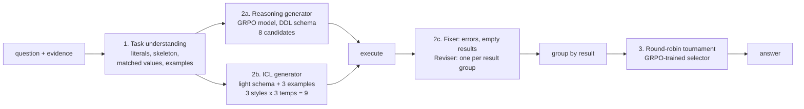

# Agentic inference: Agentar-Scale-SQL around the GRPO model

The GRPO model writes one query at a time. **Agentar-Scale-SQL** (Wang et al., Ant Group, 2025,
[arXiv:2509.24403](https://arxiv.org/abs/2509.24403)) wraps a model like it in a pipeline that spends
more compute at test time, and it took first place on the BIRD leaderboard with 81.67% execution accuracy
on the test set (74.90% on dev). By November 2026 four entries rank above it (AskData at 83.40%, then
GrainSQL, DataGallery-Text2SQL and SiriusAI-SQL). None of those four has released its method and code, so
Agentar-Scale-SQL is still the strongest one that can be replicated. `src/datalens/agent/` replicates it
around the 3B GRPO model.

## Why it suits this model

On BIRD dev the 3B GRPO model gets 51.8% greedy and 60.0% with 16-vote self-consistency, but **74.7% of
questions have at least one correct query among its 16 samples**. Voting is losing most of those 14.7
points, because the most frequent result is often wrong. Agentar-Scale-SQL's answer is a more diverse
candidate pool plus a trained judge instead of a vote.

## What the paper does

It combines three kinds of test-time scaling:

* **Internal scaling:** a generator trained with GRPO and an execution reward (1 if the result matches,
  0.1 if the query runs, 0 otherwise). That is exactly how the DataLens GRPO model was trained.
* **Sequential scaling:** an iterative fixer and reviser driven by execution results.
* **Parallel scaling:** candidates from two different generators, then a pairwise tournament judged by a
  selector that is itself trained with GRPO.



The paper's ablation on BIRD dev (its Table 2) shows where the accuracy comes from:

| Variant | Total EX | Δ |
|---|---:|---:|
| Agentar-Scale-SQL | 74.90 | |
| w/o task understanding | 74.45 | −0.45 |
| w/o reasoning generator | 70.01 | −4.89 |
| w/o ICL generator | 71.12 | −3.78 |
| w/o iterative refinement | 74.38 | −0.52 |
| w/o selection scaling (vote instead) | 73.08 | −1.82 |

## The paper's models and ours

The paper uses six models. This replication uses the Qwen2.5-Coder-3B family for every role, so the result
measures what the method adds to a small model rather than what a frontier model adds.

| Role | Paper | Here |
|---|---|---|
| Task understanding | Gemini-2.5-Flash | Qwen2.5-Coder-3B-Instruct |
| Reasoning generator | OmniSQL-32B + GRPO | **the DataLens GRPO 3B model** (LoRA adapter) |
| ICL generator | Gemini-2.5-Pro (T=0.5, 1.8) and GPT-5 | Qwen2.5-Coder-3B-Instruct (T=0.2, 0.6, 1.0) |
| Fixer, reviser | Gemini-2.5-Pro | Qwen2.5-Coder-3B-Instruct |
| Selector | Qwen2.5-Coder-32B-Instruct + GRPO | Qwen2.5-Coder-3B-Instruct + GRPO (LoRA adapter) |
| Retrieval embeddings | all-MiniLM-L6-v2 | all-MiniLM-L6-v2 (TF-IDF if not installed) |

One vLLM engine serves the base model, and the two fine-tuned roles are LoRA adapters applied per request.
Any role can point at another model in the config (for instance a Claude model through the `anthropic`
backend, which is closer to the paper's Gemini-based roles).

## Step by step

| Stage | Code | What it does |
|---|---|---|
| Offline | `values.py`, `examples.py` | Index every distinct non-numeric text value (≤ 40 chars) of each database. Build the example store: the understanding model writes a skeleton for every BIRD train question, which is embedded. |
| `understand` | `stages.understand` | The model extracts database literals and a question skeleton (paper Fig. 9, JSON). Values that appear in the question (OmniSQL's rule: more than 85% of the value verbatim) plus close matches to the extracted literals become "matched contents". The 3 train questions with the most similar skeleton become few-shot examples. |
| `reason` | `stages.reason` | 8 samples (T=0.8) from the GRPO model with **the exact prompt it was trained on**. Matched values are listed first among a column's example values, which is how OmniSQL and the released Agentar code add them, so the prompt keeps its shape. |
| `icl` | `stages.icl` | 9 candidates: direct, chain-of-thought and divide-and-conquer prompts, each at 3 temperatures. Each uses the Markdown light schema with column descriptions and examples in shuffled order. |
| `refine` | `stages.refine` | Candidates are grouped by execution outcome, and one random member per group is refined. The fixer gets failing queries and empty results (paper Fig. 15). The reviser gets one query per result group and looks for logical errors. Fixes that still fail go back to the fixer (2 rounds). Rewrites are added to the pool. |
| `select` | `stages.select` | Group the pool by result; the 16 most-voted groups play a round-robin; the selector (paper Fig. 17) answers `\boxed{1}` or `\boxed{2}` for each pair; the most wins takes it, ties go to more votes. |

### Training the selector (paper section 3.4.2)

The selector learns from the generator's own mistakes:

1. Run the generation stages on 4,000 BIRD train questions (few-shot examples come from other train
   databases, as they would at test time): `configs/agent/agentar-qwen2.5-coder-3b-train.yaml`.
2. `datalens agent selector-data` pairs each correct result with the most-voted wrong one (a hard
   negative) and one more wrong one, in random order, as the exact prompt the selector sees.
3. `datalens train grpo configs/train/grpo-selector-qwen2.5-coder-3b.yaml`: GRPO with reward 1 for the
   right `\boxed{}` label, the same recipe and code as the generator (`task: selection`).

## Running it

```bash
pip install -e ".[train,eval,vllm,agent]"
datalens agent index configs/agent/agentar-qwen2.5-coder-3b-zeroshot.yaml   # optional, offline step

# No training needed: the base model judges zero-shot
datalens agent run configs/agent/agentar-qwen2.5-coder-3b-zeroshot.yaml
datalens eval score runs/agentar-qwen2.5-coder-3b-zeroshot
datalens agent analyze runs/agentar-qwen2.5-coder-3b-zeroshot --baseline runs/grpo-qwen2.5-coder-3b

# The paper's selector
datalens agent run configs/agent/agentar-qwen2.5-coder-3b-train.yaml --stage understand --stage reason --stage icl --stage refine
datalens agent selector-data runs/agentar-qwen2.5-coder-3b-train
datalens train grpo configs/train/grpo-selector-qwen2.5-coder-3b.yaml
datalens agent run configs/agent/agentar-qwen2.5-coder-3b.yaml
```

[`notebooks/colab_agent.ipynb`](../notebooks/colab_agent.ipynb) runs all of this on a Colab G4 or A100, one
stage per process. Every stage appends to its own file and resumes after a disconnect. Use `--stage` to run
one stage, `--limit 50` for a quick trial, and `--set` for any config value, e.g.
`--set selection.method=vote` or `--set understanding.enabled=false`.

The run folder holds one file per stage (`understanding.jsonl`, `reasoning.jsonl`, `icl.jsonl`,
`refinement.jsonl`, `selection.jsonl`, with every candidate, its execution result and the selector's
judgments) and the files an evaluation run has (`generations.jsonl`, `config.yaml`). Scoring and reports
treat the agent like any other model. Its answer is scored as the greedy answer, and its 17 generated
candidates as samples, so the report's "EX with SC" for the agent is a majority vote over those 17.

## Analysis

`datalens agent analyze RUN` writes `analysis.md` with:

* the paper's ablation table, computed from the one run: each variant re-scores the tournament with only
  the candidates and judgments that remain (dropping task understanding changes the prompts, so it needs a
  separate run; pass it with `--compare`);
* voting accuracy, selection accuracy and upper bound per generator, and the overlap of what each solves
  (paper Fig. 3-5);
* pass@k as the number of generated candidates grows, by difficulty (Fig. 6);
* the selector's accuracy on pairs where exactly one query is right, and its position bias;
* calls, tokens and GPU time per stage;
* with `--baseline`, a paired test against another scored run (McNemar and a bootstrap CI).

## Where this differs from the paper

| | Paper | Here | Why |
|---|---|---|---|
| Models | Gemini-2.5-Pro/Flash, GPT-5, 32B open models | 3B models in every role | The study is about small models; any role can be swapped in the config. |
| Cell retrieval | Embedding search in a Chroma store of cells, plus BM25 with Lucene for the DDL prompt | One token index with OmniSQL's verbatim-match rule, plus edit-similarity matches for the extracted literals | No Java or vector-database dependency; literals in BIRD questions are mostly verbatim. |
| Prompt order | Examples before schema | Schema first | The schema prefix then repeats across a database's questions, so prefix caching reuses it. |
| Direct, decomposition, reviser prompts | Not printed in the paper | Written in the style of the printed ones | The task-understanding, CoT, fixer and selector prompts are the paper's. |
| Tournament size | Every result group (up to 561 comparisons) | The 16 most-voted groups (up to 120) | Caps compute; only the groups with the fewest votes are left out. `--set selection.max_candidates=null` plays them all. |
| Selector training data | 8.5k samples | Pairs from 4,000 train questions; 400 GRPO steps use 3,200 | One GPU's budget; raise `sample` and `max_steps` for more. |
| Ablations | Separate runs | Re-scored from one run (except task understanding) | One run instead of five; the representative query of a result group can differ from a true rerun. |

## Cost

Per question, the pipeline calls the model once for task understanding, once for the reasoning generator
(8 samples), 9 times for the ICL generator, about once per distinct result for refinement, and once per pair
for selection: m(m−1)/2 pairs for m result groups, at most 120. The paper reports 20 to 630 calls per
question. With a 3B model and vLLM batching a whole stage at once, the planning estimate for BIRD dev
(1,534 questions) is one to two hours on one A100 or G4 (an estimate, not a measurement). `agent analyze`
reports the measured GPU time per stage, and `eval report` prices it like every other local model.

## Expectations

No numbers yet: the runs happen on Colab. For calibration, the paper gains 1.82 points from the tournament
over voting with 32B and frontier models, and CSC-SQL, a lighter scheme, reports 65.28% on BIRD dev with a
GRPO-trained 3B generator plus a GRPO-trained 3B merge reviser. Whether the full pipeline lifts the 3B model
above 60.0% (its 16-vote self-consistency) is the question these runs answer; the paired test against
`runs/grpo-qwen2.5-coder-3b` says whether a difference is real.
